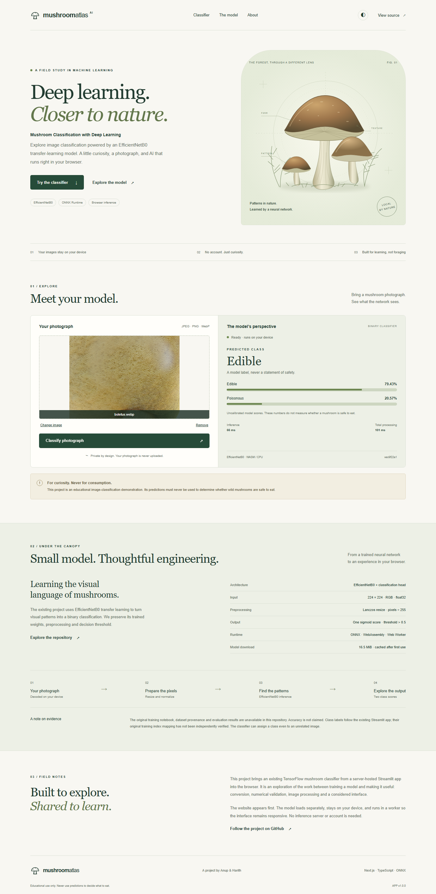

# Mushroom Atlas

**Live website: https://mushroom-atlas.vercel.app**

A Next.js portfolio website that runs the existing EfficientNetB0 mushroom classifier locally in the browser. The original TensorFlow model and Streamlit application are preserved.



## Run the website

Node.js 22 is recommended. From the repository root:

```sh
cd web
npm install
npm run dev
```

Open the URL printed by Next.js. The page renders before the model loads. All runtime assets are served locally; uploaded images stay in the browser.

```sh
npm run lint
npm run typecheck
npm run build
npm run preview
```

The production preview serves `web/out` at http://127.0.0.1:4173. Deployment does not install or run Python. For static export, use `npm run preview`, not `next start`.

## Model and provenance

- Original artifact: `mushroom_model.h5`, 27,059,216 bytes, TensorFlow/Keras.
- Existing app identifies its backbone as EfficientNetB0; the saved graph contains the corresponding convolutional blocks and custom `FixedDropout` layers.
- Inspected input: `(batch, 224, 224, 3)`, RGB float32. Converted inference fixes batch size to one.
- 4,377,757 parameters; global average pooling, Dense(256, ReLU), Dropout(0.8), Dense(1, sigmoid) classification head.
- No input Rescaling/Normalization layer is present. BatchNormalization layers are internal network operations and remain in the converted graph.
- Preprocessing follows `streamlit_app.py`: RGB conversion, Pillow Lanczos resize to 224 × 224, float32 division by 255. Do not add standard ImageNet normalization.
- Output `p` maps to `Poisonous` when `p > 0.5`; otherwise `Edible`. Display scores are `1-p` and `p`, not calibrated safety probabilities.
- **Training notebook, training dataset provenance, original class-index export, split methodology and evaluation metrics are unavailable.** Transfer learning is described by the existing app, but its full training procedure cannot be reconstructed. Labels follow that app and are not independently verified against training data. No accuracy claim is made.

## Browser architecture

Next.js App Router, TypeScript and Tailwind/CSS produce a static export. A dedicated worker loads ONNX Runtime Web 1.20.1 and executes WASM on one CPU thread; cross-origin isolation and a GPU are not required. Rendering, upload controls and navigation stay separate from inference.

The model is 17,326,996 bytes (16.52 MiB), served from a content-hashed URL. The worker checks SHA-256, stores validated bytes in Cache Storage, and removes obsolete cached model versions. If browser storage is unavailable, HTTP caching remains available. Vercel headers make versioned model/runtime assets immutable and revalidate the manifest. There are no analytics, authentication, external inference APIs or image uploads.

Initial model + WASM transfer is about 28.6 MB before transport compression. Returning visitors can reuse cached assets, subject to browser eviction. Model initialization still runs after each reload. Single-thread WASM is the tested baseline; GPU acceleration and quantization are intentionally deferred until broader validation data supports changing precision or runtime.

### Input limitations

JPEG, PNG and WebP, up to 16 MiB and 24 megapixels. Transparent images are rejected: canvas cannot retain hidden RGB values the same way Pillow's `convert('RGB')` does. Native image decoders can vary, especially for JPEG, EXIF orientation and color profiles. RGB Lanczos resizing is tested pixel-for-pixel; decoder equality for every possible image is not claimed. Invalid/corrupt uploads, download errors, unsupported browser features and timeouts have visible recovery states.

## Reproduce conversion

Python 3.10 is used for the isolated conversion environment. This avoids changing the original Streamlit requirements or depending on Keras 3 compatibility.

```sh
python -m venv .venv-convert
# Windows
.venv-convert\Scripts\python -m pip install -r scripts/requirements-convert-lock.txt
.venv-convert\Scripts\python scripts/convert_model.py
.venv-convert\Scripts\python scripts/validate_real_images.py
```

On macOS/Linux use `.venv-convert/bin/python`; the Windows freeze includes `tensorflow-intel` and `pyreadline3`, so install the portable direct requirements `scripts/requirements-convert.txt` instead. The exact validated environment is Windows/Python 3.10, TensorFlow 2.13.0, Keras 2.13.1, tf2onnx 1.16.1, ONNX 1.17.0 and ONNX Runtime 1.20.1.

The script loads the custom dropout class, disables training behavior, exports ONNX opset 17, compares outputs and writes a manifest and audit. No weights are retrained. Rebuild the website after regeneration. Remove superseded model files only after verifying the new artifact; retain the original `.h5` reference.

Additional images can be supplied with `scripts/convert_model.py --images PATH`. Use a representative validation dataset when available; the included checks cannot establish accuracy or near-boundary agreement across the original data distribution.

## Verification

```sh
cd web
npx playwright install chromium firefox webkit
npm run build
npm test
```

Tests exercise actual worker inference, exact Lanczos preprocessing, original-TensorFlow comparison, real-image JPEG/PNG/WebP fixtures, corrupt files, manifest failures/retry, transparency rejection, light/dark accessibility, and mobile viewport operation. Browser-engine testing is not physical-device testing.

- [Conversion report](docs/conversion-report.json): 11 synthetic cases, maximum absolute score difference 0.000003815, all class decisions agree.
- [Real-image reference report](docs/real-image-report.json): two source photographs in three formats, all TensorFlow/ONNX class decisions agree. These are numerical smoke tests, **not an accuracy benchmark**.
- Per-browser comparison reports are in `docs/`.
- Test photographs have their own [attribution and licenses](web/tests/fixtures/real/CREDITS.md).
- [Performance and limitations](docs/VALIDATION.md).

Run `npm run preview` in one terminal, then `npm run benchmark` in another for local cold/warm loading metrics and Lighthouse. This requires Playwright Chromium and a free debugging port 9222. Do not interpret localhost timing as internet download performance.

## Vercel deployment

Import `buanupgit/mushroom_classifier`, select the migration branch, and set **Root Directory to `web`**. Framework preset: **Other** (`framework: null` in `vercel.json`), because Next.js produces a static export. Build: `npm run build`. Output: `out`. No Python build, database or paid inference service is needed.

Or, from `web`:

```sh
npx vercel login
npx vercel --prod
```

Authenticate with your own Vercel account; do not put tokens in the repository. Set `NEXT_PUBLIC_SITE_URL` to the canonical URL for social metadata if necessary; Vercel's production URL environment variable is used when available. `web/vercel.json` defines deployment and caching headers.

The architecture is suitable for a personal Hobby portfolio within plan quotas. Model and runtime files are each below the documented 100 MB static-file limit. Bandwidth still applies: the first model/runtime download is substantial. See [Vercel limits](https://vercel.com/docs/limits) and [Hobby plan](https://vercel.com/docs/plans/hobby); free hosting is not an unlimited-service guarantee.

Deployment verified on 17 October 2026 (Europe/Oslo): six real-image fixtures matched the original TensorFlow predictions, with maximum absolute score difference 0.000001953. The public URL loads without authentication, model cache headers are correct, and no external/image-upload requests were observed. See [live verification](docs/live-report.json).

For future deployments, verify the live model, asset caching headers and a real prediction. To run browser tests against the site set `TEST_BASE_URL` to its HTTPS URL. A successful local build alone does not establish live deployment.

## Existing Streamlit app

`streamlit_app.py`, `utils.py`, the original `.h5` model and `requirements.txt` are unchanged. The previous README is preserved in [docs/STREAMLIT_README.md](docs/STREAMLIT_README.md), and [STREAMLIT_DEPLOYMENT.md](STREAMLIT_DEPLOYMENT.md) remains available. Neither historical document should be treated as verified current hosting limits or model-size information.

## Safety and attribution

This project is an educational image-classification demonstration. Its predictions must never be used to determine whether wild mushrooms are safe to eat.

Original project attribution: Anup & Harith, as recorded in the existing repository. The browser migration preserves their trained artifact. The botanical SVG is an illustrative design asset, not a specimen-identification guide.
